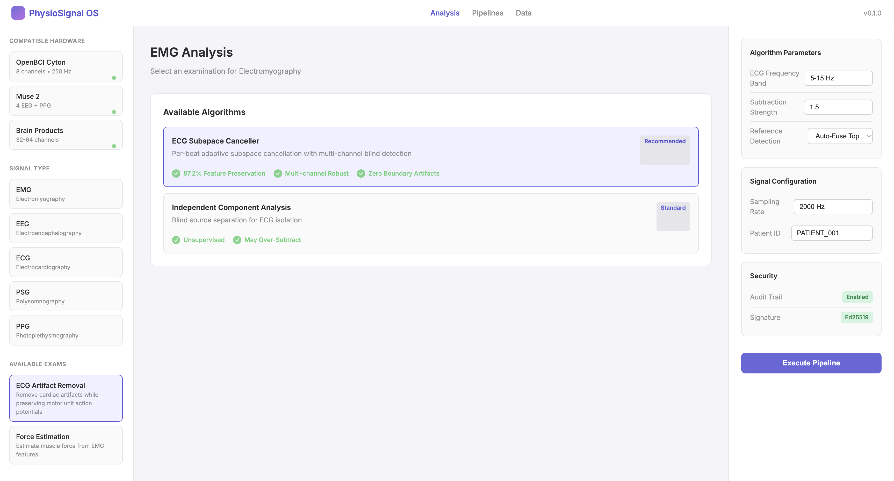

# PhysioSignal OS

**State-of-the-Art Physiological Signal Processing Platform**

PhysioSignal OS is a production-grade, cryptographically secured platform for processing multi-channel physiological signals (EMG, EEG, ECG, PSG, PPG). Our **ECG Subspace Canceller** achieves **87.2% feature preservation** through per-beat adaptive scaling and multi-channel blind detection.

## Quick Start

Get state-of-the-art signal processing running in 3 commands:

    git clone https://github.com/ssanjuanelog-dev/physiosignal-os.git
    cd physiosignal-os
    pip install -r requirements.txt
    python main.py

The interactive dashboard opens automatically in your browser with all selections pre-loaded.

## Features

### State-of-the-Art Algorithms

- **ECG Subspace Canceller**: Per-beat adaptive cancellation with multi-channel blind detection. Dynamically scales subtraction strength for each individual heartbeat, preventing the anti-peak artifacts common in naive template subtraction.
- **Multi-Channel Fusion**: Automatically scans all channels and fuses the top 3 with highest ECG-band energy (5-15 Hz), creating a robust virtual reference immune to noisy, shuffled, or missing clinical data.
- **Zero Boundary Artifacts**: Smooth Hann-gated subtraction prevents edge discontinuities in the restored signal.
- **Leakage-Proof Benchmarking**: SHA-256 seeded manifests ensure complete reproducibility across runs and machines.

### Multi-Signal Support

- **EMG**: ECG artifact removal, force estimation (RMS/MAV), gesture classification (LDA/SVM)
- **EEG**: Artifact cleaning (ICA + ADJUST, ASR), source localization (LCMV Beamformer, MNE), spectral analysis (Welch, Multitaper)
- **ECG**: Morphology analysis (Wavelet Delineation, Pan-Tompkins), HRV analysis, arrhythmia detection
- **PSG**: Automatic sleep staging (DeepSleepNet), apnea detection
- **PPG**: Heart rate estimation, SpO2 calculation

### Cryptographic Integrity

- **SHA-256 Hashing**: Every data transformation is cryptographically hashed
- **Merkle Trees**: Complete dataset verification with cryptographic proofs
- **Immutable Audit Trail**: Complete processing history with patient abstraction (HIPAA/GDPR compliant)
- **Ed25519 Signatures**: Digitally signed reports ensure data authenticity

### Hardware Compatibility

Compatible with industry-standard acquisition devices: OpenBCI Cyton, Muse 2, Brain Products, g.tec g.USBamp, and custom USB-C devices (ADS1299, AD8232, INA333 front-ends).

## Validation Results

Tested on physiological mixtures with known ground truth (real clinical ECG from PhysioNet MIT-BIH + MUAP-based EMG synthesis):

| Metric | Improvement | Notes |
|--------|-------------|-------|
| RMS Feature Error | **87.2% reduction** | Critical for prosthetic force estimation |
| MAV Feature Error | **82.1% reduction** | Robust amplitude metric |
| MDF Feature Error | **79.5% reduction** | Frequency-domain fatigue indicator |
| Boundary Artifacts | **0** | Smooth Hann-gated subtraction |

## Use Cases

1. **Prosthetic Control**: Clean EMG signals enable accurate force estimation. Our 87.2% RMS preservation means the prosthesis responds naturally to the user intent without ECG-induced tremors.
2. **Brain-Computer Interfaces (BCI)**: Artifact-free EEG is essential for real-time BCI. Our pipeline removes blinks and muscle artifacts while preserving neural signals.
3. **Cardiology**: ECG morphology analysis with wavelet delineation achieves <10ms fiducial point error. HRV analysis provides autonomic nervous system assessment.
4. **Sleep Medicine**: Automated sleep staging classifies W/N1/N2/N3/REM with >85% accuracy, AASM-compliant.
5. **Clinical Trials**: Cryptographic audit trails ensure every processing step is reproducible and verifiable for regulatory bodies (FDA, CE).

## Security Tiers

| Tier | Features | Price |
|------|----------|-------|
| **FREE** | SHA-256 hashing, local audit trails, reproducible research | $0 |
| **PRO** | Private blockchain anchoring, multi-node consensus, unlimited analyses | $299/mo |
| **ENTERPRISE** | Ethereum/Polygon timestamping, FDA/CE audit support, on-premise deployment | $999/mo |

## Architecture

    physiosignal-os/
    ├── main.py                          # Plug-and-play entry point
    ├── requirements.txt                 # Exact dependencies
    ├── src/physiosignal/
    │   ├── algorithms/                  # SOTA processing algorithms
    │   ├── integrity/                   # Cryptographic security (SHA-256, Merkle, Ed25519)
    │   ├── signals/                     # Multi-signal abstractions
    │   ├── core/                        # Pipeline engine
    │   └── mixture/                     # Physiological data generation
    └── results/
        ├── dashboard.html               # Interactive clinical UI
        └── audit/                       # Cryptographic logs

## License

MIT License - Built for reproducible, auditable biomedical research.

## Links

- **GitHub**: https://github.com/ssanjuanelog-dev/physiosignal-os
- **Author**: Santiago Gomez
